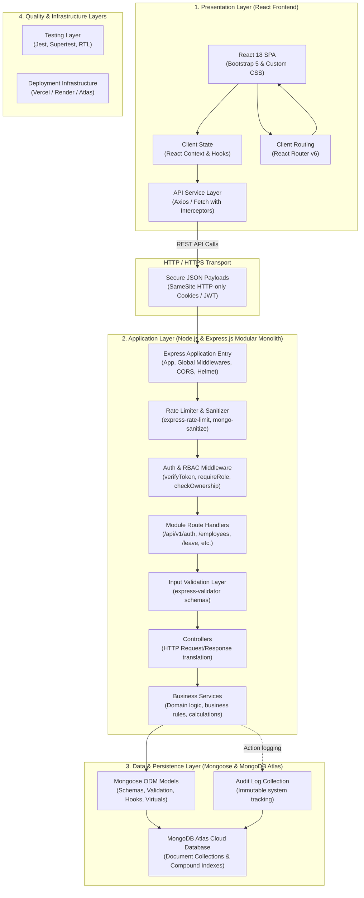
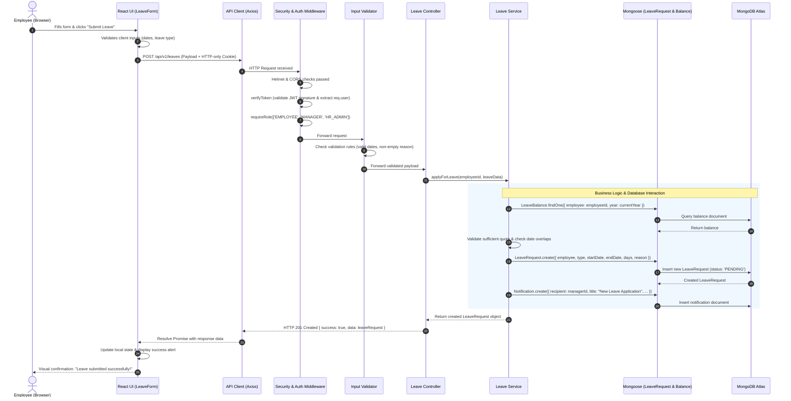

# StaffSync — System Architecture Specification

**Tagline:** People First. Work Smarter.  
**Architecture Style:** Layered Modular Monolith  
**Tech Stack:** MERN (MongoDB, Express.js, React.js, Node.js) + Bootstrap 5  
**Version:** 1.0.0 (Phase 1 Specification)  

---

## 1. Architectural Philosophy & Strategy

StaffSync is architected as a **Layered Modular Monolith**. For an individual student project, a modular monolith provides significant architectural advantages over microservices:
1. **Operational Simplicity:** Eliminates distributed systems complexity, network latency overhead, multi-service deployment orchestrations, and distributed transaction management.
2. **Clear Boundaries:** Modules (Auth, Employees, Attendance, Leave, Announcements, Training) maintain strict code separation through dedicated routes, controllers, services, and models, allowing future microservice extraction if needed.
3. **Single Repository & Unified CI/CD:** A cohesive codebase (`client/`, `server/`, `docs/`) simplifies local development, testing, and continuous deployment.
4. **Consistency & Maintainability:** Shared validation standards, uniform error handling, and centralized authentication middleware ensure a consistent developer experience and high code maintainability.

---

## 2. High-Level System Architecture Diagram



---

## 3. Layered Architectural Decomposition

### 3.1 Layer 1: Presentation Layer (React.js Single Page Application)
* **Technology:** React 18, React Router v6, Bootstrap 5, Bootstrap Icons, Custom CSS.
* **Responsibilities:**
  * Render user interfaces based on role permissions (Employee, Manager, HR/Admin).
  * Manage local and global client state (authenticated user context, active alerts, notification counts).
  * Intercept and normalize client-side routing, preventing unauthenticated access to protected pages.
  * Provide accessible, interactive forms with client-side feedback (validation error tooltips, loading indicators, success toasts).
* **Key Subcomponents:**
  * **Layouts:** `AuthLayout` (login, clean branded layout), `DashboardLayout` (sidebar, top navbar, breadcrumbs, content viewport).
  * **Pages:** Role-tailored dashboards, employee directory, leave application, attendance clock, etc.
  * **Components:** Reusable UI elements (`DataTable`, `StatCard`, `StatusBadge`, `ModalDialog`, `ConfirmButton`).

### 3.2 Layer 2: API Communication & Network Layer
* **Technology:** Axios instance with standardized request and response interceptors.
* **Responsibilities:**
  * Provide modular, typed API service modules (`authService.js`, `employeeService.js`, `leaveService.js`).
  * Attach appropriate headers and configure `withCredentials: true` for HTTP-only cookie exchange.
  * Uniformly intercept HTTP error responses (e.g., 401 Unauthorized, 403 Forbidden, 422 Validation Error, 500 Server Error) to trigger global notifications or redirect to login.

### 3.3 Layer 3: Application Server & Middleware Pipeline (Express.js)
* **Technology:** Node.js LTS, Express 4.x/5.x.
* **Responsibilities:**
  * Initialize the HTTP server and configure security headers via `helmet`.
  * Manage Cross-Origin Resource Sharing (`cors`) restricted to configured client origins.
  * Parse incoming JSON payloads (`express.json({ limit: '10kb' })`) and cookie headers (`cookie-parser`).
  * Mitigate denial-of-service and brute-force attacks via `express-rate-limit`.
  * Sanitize inputs against NoSQL query selector injection using `mongo-sanitize`.

### 3.4 Layer 4: Authentication & Authorization Middleware
* **Responsibilities:**
  * `verifyToken`: Decodes and verifies the JWT signature; populates `req.user` with `{ id, email, role, employeeId, departmentId }`.
  * `requireRole([...roles])`: Verifies that the authenticated user possesses the required role (e.g., `HR_ADMIN`, `MANAGER`, `EMPLOYEE`).
  * `checkOwnership / checkDepartment`: Resource-level authorization ensuring Managers can only review their team's data and Employees can only access their personal records.

### 3.5 Layer 5: Route Handlers & Input Validation
* **Technology:** Express Router, `express-validator`.
* **Responsibilities:**
  * Map incoming REST endpoints (`GET`, `POST`, `PUT`, `DELETE`) to corresponding controller functions.
  * Enforce strict declarative validation rules on incoming parameters, queries, and bodies.
  * Halt invalid requests immediately with structured HTTP 400/422 responses before invoking business logic.

### 3.6 Layer 6: Controllers Layer
* **Responsibilities:**
  * Extract sanitized input data from `req.body`, `req.params`, and `req.query`.
  * Delegate business operations to the appropriate Domain Service.
  * Format and return standardized HTTP JSON responses with appropriate status codes (`200 OK`, `201 Created`, `204 No Content`).
  * Catch unhandled rejections and forward them to the global centralized error handler.

### 3.7 Layer 7: Business Services Layer
* **Responsibilities:**
  * Encapsulate core organizational business rules (e.g., leave quota calculation, attendance status determination, overlapping leave detection).
  * Orchestrate transactions across multiple models (e.g., approving a leave request updates `LeaveRequest`, decrements `LeaveBalance`, and creates an in-app `Notification`).
  * Decouple database queries from HTTP request/response mechanics, facilitating isolated unit testing.

### 3.8 Layer 8: Data Models & Persistence Layer
* **Technology:** MongoDB Atlas, Mongoose 8.x ODM.
* **Responsibilities:**
  * Enforce schema-level constraints, defaults, and data types.
  * Define compound and single-field database indexes to ensure rapid query execution.
  * Execute Mongoose lifecycle hooks (e.g., pre-save password hashing) and virtual properties.

### 3.9 Layer 9: Testing Layer
* **Technology:** Jest, Supertest, React Testing Library.
* **Responsibilities:**
  * Execute unit tests for business logic services.
  * Execute automated integration tests for backend API routes and authorization policies.
  * Verify frontend component rendering and form state transitions.

### 3.10 Layer 10: Deployment & Hosting Infrastructure
* **Technology:** MongoDB Atlas (Cloud Database), Render/Railway (Backend Node API), Vercel/Netlify (Frontend React SPA).
* **Responsibilities:**
  * Provide secure HTTPS transport, automated continuous deployment from GitHub main branches, environment variable injection, and automated build verification.

---

## 4. End-to-End Request Flow Diagram

The following sequence diagram details the complete lifecycle of a representative business transaction: an **Employee Submitting a Leave Application**.



---

## 5. Architectural Quality Attributes & Design Decisions

### 5.1 Modularity & Directory Decoupling
To prevent the application from degrading into an unwieldy monolith, code is structured around functional business domains rather than purely technical categories. Each domain encompasses its dedicated route, controller, service, and validation rules.

### 5.2 Uniform API Response Contract
All REST endpoints adhere to a predictable JSON envelope:

```json
// Successful Response
{
  "success": true,
  "statusCode": 200,
  "message": "Operation completed successfully.",
  "data": { ... },
  "pagination": {
    "page": 1,
    "limit": 10,
    "totalRecords": 45,
    "totalPages": 5
  }
}

// Error Response
{
  "success": false,
  "statusCode": 400,
  "error": "Validation Error",
  "message": "End date cannot be earlier than start date.",
  "details": [
    { "field": "endDate", "issue": "Must be equal to or after startDate" }
  ]
}
```

### 5.3 Centralized Error Handling Pipeline
No controller will leak raw database exceptions or internal stack traces to the client. All asynchronous operations are wrapped in an `asyncHandler` utility that catches errors and directs them to a global Express error-handling middleware:
* **Operational Errors (e.g., 400 Bad Request, 404 Not Found, 403 Forbidden):** Formatted and returned with descriptive user messages.
* **Systemic Errors (e.g., 500 Internal Server Error, database connection drops):** Logged securely on the server with sanitized error messages returned to the client.

### 5.4 Statelessness & Scalability
The backend maintains zero session state in local server memory. All authentication state is cryptographically encapsulated within signed JWTs. This stateless architecture ensures that the server can restart or scale horizontally without disrupting active user sessions.

---

## 6. Proposed Project Directory Structure

StaffSync maintains a clean separation between frontend, backend, and documentation in a beginner-friendly monorepo layout:

```text
StaffSync/
├── .gitignore                      # Git ignore rules for node_modules, env, logs
├── README.md                       # Main project introduction & setup guide
├── docs/                           # Comprehensive architectural specifications
│   ├── PROJECT_PLAN.md             # Requirements, scope, and functional IDs
│   ├── ARCHITECTURE.md            # System architecture & directory structure
│   ├── DATABASE_DESIGN.md         # Database collections, schemas, and ERD
│   ├── API_SPECIFICATION.md       # Complete REST endpoint catalog
│   ├── SECURITY_DESIGN.md         # Security, auth, RBAC, and input validation
│   ├── UI_UX_BLUEPRINT.md         # Route hierarchy, components, and design system
│   ├── TESTING_STRATEGY.md        # Testing pyramid, tools, and acceptance criteria
│   ├── IMPLEMENTATION_ROADMAP.md  # 15-phase implementation plan
│   ├── DEPLOYMENT_PLAN.md         # Production deployment & cloud architecture
│   ├── DECISIONS.md               # Architectural decision records (ADRs)
│   └── PROGRESS.md                # Phase-by-phase execution tracker
│
├── client/                         # Frontend Application (React 18 + Vite / CRA)
│   ├── public/                     # Static assets, favicon, logo
│   ├── src/
│   │   ├── api/                    # Axios instances & domain API client calls
│   │   │   ├── apiClient.js        # Global Axios instance with interceptors
│   │   │   ├── authService.js      # Auth API endpoints (login, logout, me)
│   │   │   ├── employeeService.js  # Employee API endpoints
│   │   │   ├── attendanceService.js# Attendance API endpoints
│   │   │   └── leaveService.js     # Leave API endpoints
│   │   ├── assets/                 # Brand illustrations, icons, custom SVGs
│   │   ├── components/             # Reusable UI building blocks
│   │   │   ├── common/             # Button, Input, Modal, Badge, Spinner
│   │   │   ├── layout/             # Navbar, Sidebar, Breadcrumb, Footer
│   │   │   ├── widgets/            # PunchClockWidget, StatCard, ChartWidget
│   │   │   └── guards/             # ProtectedRoute, RoleGuard
│   │   ├── context/                # React Context providers (AuthContext, AlertContext)
│   │   ├── hooks/                  # Custom React hooks (useAuth, useFetch)
│   │   ├── layouts/                # Structural templates (AuthLayout, DashboardLayout)
│   │   ├── pages/                  # Top-level route view components
│   │   │   ├── auth/               # LoginPage, UnauthorizedPage
│   │   │   ├── dashboard/          # EmployeeDashboard, ManagerDashboard, HRDashboard
│   │   │   ├── employees/          # EmployeeDirectory, ProfileView, CreateEmployee
│   │   │   ├── departments/        # DepartmentListPage, DepartmentModal
│   │   │   ├── attendance/         # AttendanceLogPage, TeamAttendancePage
│   │   │   ├── leaves/             # LeaveApplicationPage, LeaveApprovalQueue
│   │   │   ├── announcements/      # AnnouncementFeed, AnnouncementEditor
│   │   │   ├── training/           # TrainingCatalog, ProgramEnrollmentPage
│   │   │   └── reports/            # HRReportsPage, AnalyticsCharts
│   │   ├── styles/                 # Custom CSS overrides and theme variables
│   │   ├── utils/                  # Date formatting, currency, string helpers
│   │   ├── App.jsx                 # Route definitions and provider composition
│   │   └── main.jsx                # React DOM entry point
│   ├── index.html                  # HTML5 entry page with Bootstrap CSS CDN/bundle
│   ├── package.json                # Frontend dependencies and build scripts
│   └── vite.config.js              # Vite bundler configuration
│
└── server/                         # Backend Application (Node.js & Express.js)
    ├── src/
    │   ├── config/                 # Database connection & environment configuration
    │   │   ├── db.js               # Mongoose connection logic with retry handler
    │   │   └── env.js              # Validated environment variable schema
    │   ├── constants/              # System constants, enums (roles, statuses)
    │   ├── controllers/            # Request handlers & response formatting
    │   │   ├── authController.js   # Login, logout, session controller
    │   │   ├── employeeController.js
    │   │   ├── attendanceController.js
    │   │   ├── leaveController.js
    │   │   └── departmentController.js
    │   ├── middlewares/            # Custom Express middleware pipeline
    │   │   ├── authMiddleware.js   # verifyToken & requireRole
    │   │   ├── errorMiddleware.js  # Global centralized error handler
    │   │   ├── rateLimiter.js      # Endpoint rate limiters
    │   │   └── validator.js        # Input validation runner
    │   ├── models/                 # Mongoose schema definitions
    │   │   ├── User.js             # Auth credentials model
    │   │   ├── Employee.js         # HR profile model
    │   │   ├── Department.js       # Department model
    │   │   ├── Attendance.js       # Time punch model
    │   │   ├── LeaveRequest.js     # Leave request model
    │   │   ├── LeaveBalance.js     # Annual leave quota model
    │   │   ├── Announcement.js     # Bulletins model
    │   │   ├── TrainingProgram.js  # Training catalog model
    │   │   ├── TrainingEnrollment.js # Enrollment tracking model
    │   │   ├── Notification.js     # In-app notifications model
    │   │   └── AuditLog.js         # Immutable audit records model
    │   ├── routes/                 # Express route definitions
    │   │   ├── authRoutes.js
    │   │   ├── employeeRoutes.js
    │   │   ├── attendanceRoutes.js
    │   │   ├── leaveRoutes.js
    │   │   ├── departmentRoutes.js
    │   │   └── index.js            # Consolidated API router mounted at /api/v1
    │   ├── services/               # Core business logic decoupled from HTTP
    │   │   ├── authService.js
    │   │   ├── employeeService.js
    │   │   ├── attendanceService.js
    │   │   └── leaveService.js
    │   ├── utils/                  # Helper utilities (token generation, calculations)
    │   ├── validators/             # express-validator schema rules
    │   ├── app.js                  # Express app setup, middleware, and route mounting
    │   └── server.js               # Server entry point listening on PORT
    ├── tests/                      # Automated backend test suites
    │   ├── unit/                   # Business service unit tests
    │   └── integration/            # API endpoint and auth integration tests
    ├── .env.example                # Template of required environment variables
    └── package.json                # Backend dependencies and scripts
```

### 6.1 Purpose of Major Directories
* **`client/src/api/`:** Centralizes all HTTP communication. Prevents Axios calls from being scattered randomly inside React components, making API changes simple to manage.
* **`client/src/components/guards/`:** Contains higher-order components that inspect user role and authentication state before allowing a component or page to render.
* **`server/src/controllers/`:** Responsible strictly for receiving the HTTP request, extracting parameters, invoking the appropriate service, and sending back the HTTP status and JSON response.
* **`server/src/services/`:** Contains pure business logic (e.g., verifying if an employee has enough vacation balance before saving a leave request). Keeps controllers lean and easily testable.
* **`server/src/models/`:** Enforces schema integrity, type safety, default values, and indexes at the database level.
* **`server/src/middlewares/`:** Reusable filters for authentication, role verification, rate limiting, and centralized error handling.

