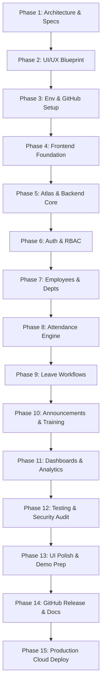

# StaffSync — 15-Phase Master Implementation Roadmap

**Project:** StaffSync — Modern Human Resource Management System  
**Framework:** Phased Agile Delivery  
**Target Audience:** Beginner Full-Stack Developer (Project Owner) & AI Pair Programmer (Antigravity)  
**Version:** 1.0.0 (Phase 1 Specification)  

---

## 1. Roadmap Overview & Execution Principles

To ensure predictable progress and avoid common beginner hurdles, StaffSync is developed across **15 structured phases**. Each phase contains explicit boundaries:
* **The Project Owner:** Handles account setups (GitHub, MongoDB Atlas, Render, Vercel), credentials entry, and terminal execution with clear, step-by-step guidance.
* **Antigravity:** Designs architecture, crafts clean boilerplate and application code, writes tests, and provides guided checklists.
* **No Phase Skipping:** Work must satisfy the **Definition of Done (DoD)** before advancing to subsequent phases.

---

## 2. Detailed Phase Specifications

---

### PHASE 1 — Requirements Analysis & Architecture Design
* **Objective:** Establish the foundational blueprint, data models, API contracts, security standards, and implementation roadmap.
* **Prerequisites:** Clean workspace directory.
* **Work Assigned to Antigravity:** Inspect workspace; author all architectural specifications in `docs/` and root `README.md`.
* **Actions Project Owner Must Perform:** Review generated documentation; confirm understanding of scope and role boundaries.
* **Expected Deliverables:** 11 documentation files in `docs/`, root `README.md`.
* **Testing Requirements:** Architectural consistency review; Mermaid syntax validation.
* **Definition of Done:** All 12 tasks completed; documentation comprehensive, consistent, and approved by project owner.
* **Dependencies:** None.

---

### PHASE 2 — UI/UX Design System & Application Blueprint
* **Objective:** Refine visual identity, page layouts, interactive wireframe specs, and Bootstrap theme definitions.
* **Prerequisites:** Phase 1 approved.
* **Work Assigned to Antigravity:** Detail color variables, component hierarchy, form layouts, chart layouts, and responsive behavior in `docs/UI_UX_BLUEPRINT.md`.
* **Actions Project Owner Must Perform:** Review visual design tokens and confirm alignment with project aesthetic goals.
* **Expected Deliverables:** Finalized UI design system specification.
* **Testing Requirements:** Color contrast verification against WCAG AA standards.
* **Definition of Done:** Clear UI blueprint ready for code implementation in Phase 4.
* **Dependencies:** Phase 1.

---

### PHASE 3 — Local Development Environment & GitHub Setup
* **Objective:** Establish local Node.js runtime, configure Git version control, and link to GitHub repository.
* **Prerequisites:** Phase 2 completed; Git and Node.js LTS installed on host machine.
* **Work Assigned to Antigravity:** Provide step-by-step CLI commands for Git initialization, `.gitignore` setup, and GitHub remote connection.
* **Actions Project Owner Must Perform:**
  1. Create a free personal GitHub account (if not already existing).
  2. Create a new GitHub repository named `StaffSync`.
  3. Execute provided `git init`, `git add`, and `git commit` commands.
  4. Link local repository to GitHub remote and push the initial commit.
* **Expected Deliverables:** Initialized local Git repository; remote GitHub repository with `main` branch.
* **Testing Requirements:** Verify `git status` reports working tree clean after commit.
* **Definition of Done:** Phase 1 and 2 documentation successfully committed and pushed to GitHub.
* **Dependencies:** Phase 2.

---

### PHASE 4 — MERN Project Initialization & Frontend Foundation
* **Objective:** Scaffold the client application using React, Vite/CRA, Bootstrap 5, and set up client routing.
* **Prerequisites:** Phase 3 completed.
* **Work Assigned to Antigravity:** Scaffold `client/` directory; install Bootstrap 5, React Router v6, and Axios; implement `AuthLayout`, `DashboardLayout`, navigation components, and stub pages.
* **Actions Project Owner Must Perform:** Run `npm run dev` in `client/` and verify the frontend loads in browser at `http://localhost:5173`.
* **Expected Deliverables:** Working React client application with functional client-side routing.
* **Testing Requirements:** Client build test (`npm run build`); responsive navigation bar toggle test.
* **Definition of Done:** Navigating between `/`, `/login`, `/dashboard`, and `/employees` displays proper layouts without console errors.
* **Dependencies:** Phase 3.

---

### PHASE 5 — MongoDB Atlas Setup & Backend Foundation
* **Objective:** Set up cloud database on MongoDB Atlas and scaffold Express backend server.
* **Prerequisites:** Phase 4 completed.
* **Work Assigned to Antigravity:** Scaffold `server/` directory; configure Express app, Mongoose connection with retry logic, global error middleware, and health check route (`/api/v1/health`).
* **Actions Project Owner Must Perform:**
  1. Create a free MongoDB Atlas account.
  2. Deploy a free M0 Shared Cluster.
  3. Configure database username and strong password.
  4. Whitelist IP address (`0.0.0.0/0` for development).
  5. Copy connection string into local `server/.env` file.
* **Expected Deliverables:** Express server connecting to live MongoDB Atlas cluster; `/api/v1/health` returning 200 OK.
* **Testing Requirements:** Automated ping test verifying database connectivity.
* **Definition of Done:** Backend starts on port 5000 and logs `"MongoDB Atlas Connected Successfully"`.
* **Dependencies:** Phase 4.

---

### PHASE 6 — Authentication & Role-Based Authorization
* **Objective:** Implement secure login, password hashing, JWT cookie management, and RBAC middleware.
* **Prerequisites:** Phase 5 completed.
* **Work Assigned to Antigravity:** Build `User` model, bcrypt hashing pre-save hooks, `authController`, `verifyToken`, and `requireRole` middleware; integrate React `AuthContext` and `ProtectedRoute`.
* **Actions Project Owner Must Perform:** Run database seed script to populate initial Admin user account; test logging in via frontend.
* **Expected Deliverables:** Functional login/logout flow; secure cookie handling; route protection.
* **Testing Requirements:** Postman/Supertest suite verifying 200 for valid login, 401 for bad password, 429 for rate limit exceeded, and 403 for unauthorized role.
* **Definition of Done:** Admin can log in, receive token cookie, access protected dashboard, and log out cleanly.
* **Dependencies:** Phase 5.

---

### PHASE 7 — Employee & Department Management
* **Objective:** Build CRUD workflows for departments, employee profiles, and organizational hierarchies.
* **Prerequisites:** Phase 6 completed.
* **Work Assigned to Antigravity:** Create `Department` and `Employee` Mongoose models; implement controller logic, input validation, and frontend management tables and modals.
* **Actions Project Owner Must Perform:** Test creating new departments and onboarding new employees via UI.
* **Expected Deliverables:** Employee Directory with search and filter; Department Manager page; Onboarding modal.
* **Testing Requirements:** Integration tests verifying duplicate employeeCode rejection and soft-deactivation.
* **Definition of Done:** HR can create departments, assign managers, onboard staff, and deactivate employee accounts.
* **Dependencies:** Phase 6.

---

### PHASE 8 — Attendance Management
* **Objective:** Implement real-time daily check-in/out engine, status calculation, and attendance reporting.
* **Prerequisites:** Phase 7 completed.
* **Work Assigned to Antigravity:** Build `Attendance` model, daily punch controller, late status detection ($>09:30\text{ AM}$), `PunchClockWidget`, and attendance history tables.
* **Actions Project Owner Must Perform:** Test clocking in and out from Employee dashboard; verify calculation of working hours.
* **Expected Deliverables:** Interactive punch widget; employee attendance log; manager team attendance view.
* **Testing Requirements:** Test suite confirming duplicate same-day punch rejection and working hour arithmetic.
* **Definition of Done:** Employee can punch in and out; manager can see live team attendance status.
* **Dependencies:** Phase 7.

---

### PHASE 9 — Leave Requests & Approval Workflows
* **Objective:** Implement leave quota management, leave applications, and manager approval/rejection lifecycle.
* **Prerequisites:** Phase 8 completed.
* **Work Assigned to Antigravity:** Build `LeaveRequest` and `LeaveBalance` models; develop quota validation logic, date overlap collision prevention, and Manager approval UI.
* **Actions Project Owner Must Perform:** Submit a test leave request as Employee; log in as Manager to approve/reject.
* **Expected Deliverables:** Leave application form; personal leave history; manager approval queue with modals.
* **Testing Requirements:** Automated tests checking balance decrement on approval and rejection if quota is exceeded.
* **Definition of Done:** Complete leave request lifecycle (Submit $\rightarrow$ Review $\rightarrow$ Approve $\rightarrow$ Balance Deduct) operational.
* **Dependencies:** Phase 8.

---

### PHASE 10 — Announcements & Training Management
* **Objective:** Implement corporate bulletin announcements and employee training program enrollment.
* **Prerequisites:** Phase 9 completed.
* **Work Assigned to Antigravity:** Build `Announcement`, `TrainingProgram`, and `TrainingEnrollment` models; implement dashboard feeds and enrollment seat counter logic.
* **Actions Project Owner Must Perform:** Create an announcement as HR; verify visibility on Employee feed; enroll in a training session.
* **Expected Deliverables:** Announcement feed with priority banners; training catalog with one-click enrollment.
* **Testing Requirements:** Test verifying training capacity decrement and duplicate enrollment prevention.
* **Definition of Done:** HR can broadcast news; employees can view notices and enroll in training courses.
* **Dependencies:** Phase 9.

---

### PHASE 11 — Dashboards, Notifications & Analytics
* **Objective:** Build dedicated role-tailored landing dashboards, in-app notification center, and visual HR analytics.
* **Prerequisites:** Phase 10 completed.
* **Work Assigned to Antigravity:** Develop analytics aggregation pipelines; build Employee, Manager, and HR dashboards; implement notification polling/bell indicator.
* **Actions Project Owner Must Perform:** Log in as each role and inspect customized dashboard widgets and notifications.
* **Expected Deliverables:** 3 specialized role dashboards; notification center; visual KPI charts.
* **Testing Requirements:** Data aggregation accuracy verification; notification read status toggle tests.
* **Definition of Done:** Dashboards render accurate live summaries of attendance, leaves, and headcount metrics.
* **Dependencies:** Phase 10.

---

### PHASE 12 — Full Integration, Testing, Security & Bug Fixing
* **Objective:** Conduct end-to-end regression testing, security vulnerability scans, and bug remediation.
* **Prerequisites:** Phase 11 completed.
* **Work Assigned to Antigravity:** Run full Jest/Supertest suite; execute OWASP security checks (NoSQL injection, XSS, rate limits, CORS); fix discovered bugs.
* **Actions Project Owner Must Perform:** Perform exploratory user acceptance testing across all roles.
* **Expected Deliverables:** Comprehensive test execution report; zero high-severity security defects.
* **Testing Requirements:** All automated test suites executed and reported as PASSED.
* **Definition of Done:** Zero breaking bugs; 100% core acceptance criteria satisfied.
* **Dependencies:** Phase 11.

---

### PHASE 13 — Final UI Polish, Documentation & Demo Preparation
* **Objective:** Elevate visual aesthetics, polish responsive behaviors, refine error messages, and prepare demo data.
* **Prerequisites:** Phase 12 completed.
* **Work Assigned to Antigravity:** Polish Bootstrap CSS styling; ensure smooth transitions and responsive mobile views; generate rich demo seed dataset.
* **Actions Project Owner Must Perform:** Seed the database with demo dataset; verify application presentation on mobile device.
* **Expected Deliverables:** Polished UI; comprehensive user guide; pre-seeded demo environment.
* **Testing Requirements:** Full responsive audit across Mobile, Tablet, and Desktop viewports.
* **Definition of Done:** Visual presentation meets professional enterprise standards.
* **Dependencies:** Phase 12.

---

### PHASE 14 — GitHub Finalization & Release
* **Objective:** Finalize project repository documentation, clean commit history, and publish GitHub Release.
* **Prerequisites:** Phase 13 completed.
* **Work Assigned to Antigravity:** Review root `README.md`, ensure architecture diagrams render cleanly; author deployment guides and contribution notes.
* **Actions Project Owner Must Perform:** Commit final files; tag and publish release `v1.0.0` on GitHub.
* **Expected Deliverables:** Clean GitHub repository with professional documentation, badges, and release tag.
* **Testing Requirements:** Clone repository to fresh directory and verify clean build instructions.
* **Definition of Done:** Repository is publicly accessible and ready for academic review.
* **Dependencies:** Phase 13.

---

### PHASE 15 — Production Deployment & Final Verification
* **Objective:** Deploy frontend and backend to production cloud platforms with live domain and HTTPS.
* **Prerequisites:** Phase 14 completed.
* **Work Assigned to Antigravity:** Provide step-by-step cloud configuration guides for Render/Railway (Backend) and Vercel (Frontend); execute production smoke tests.
* **Actions Project Owner Must Perform:**
  1. Create Render / Railway account and link GitHub repository for backend service.
  2. Configure environment variables (`MONGO_URI`, `JWT_SECRET`, `CLIENT_URL`) in hosting dashboard.
  3. Create Vercel account and deploy `client/` frontend repository.
  4. Update `CLIENT_URL` and API base URLs with live production domains.
* **Expected Deliverables:** Live, publicly accessible web application on HTTPS; production health-check passing.
* **Testing Requirements:** Live production smoke test verifying login, check-in, and leave submission.
* **Definition of Done:** Application fully operational in production; public URL submitted for academic evaluation.
* **Dependencies:** Phase 14.

