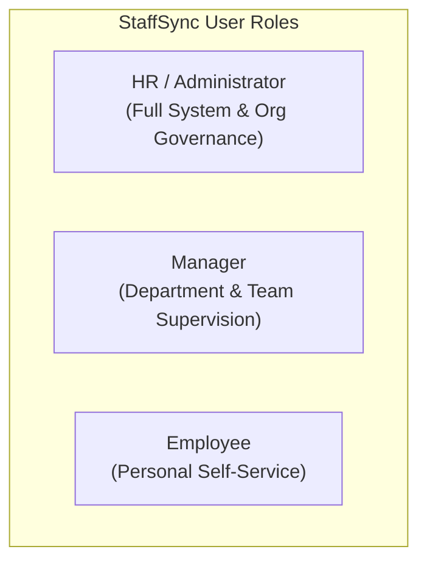

# StaffSync — Modern Human Resource Management System
## Project Plan & Requirements Analysis

**Tagline:** People First. Work Smarter.  
**Version:** 1.0.0 (Phase 1 Specification)  
**Author:** StaffSync Architecture & Engineering Team  
**Status:** Approved for Implementation Planning  

---

## 1. Executive Summary & Project Overview

**StaffSync** is a modern, responsive, web-based Human Resource Management System (HRMS) developed for ServiceNow University / SkillWallet. Designed as an individual full-stack application utilizing the **MERN** stack (MongoDB, Express.js, React.js, Node.js) with Bootstrap 5 and custom CSS, StaffSync digitizes and streamlines core organizational human resource workflows.

In traditional small-to-medium organizations, human resource workflows often suffer from fragmented manual processes: paper-based attendance registers, email chains for leave requests, unorganized employee files, and manual tracking of training programs. StaffSync solves these issues by unifying employee data management, role-based self-service, real-time attendance tracking, leave lifecycle workflows, training schedules, and executive HR analytics into an intuitive, secure single-page web application.

---

## 2. Workspace Assessment (Task 1)

* **Directory Evaluated:** `c:\Users\Ideapad\OneDrive\Documents\StaffSync`
* **Current State:** Clean, empty workspace.
* **Existing Files Found:** 0 files, 0 directories.
* **Application Code Overwrite Risk:** Zero. No legacy code exists.
* **Environment Integrity:** No package managers (npm/pnpm/yarn) have been run, no Git repositories initialized, and no third-party credentials or API keys have been requested or stored.
* **Recommendation:** Proceed with architectural documentation and project planning inside `docs/` and root `README.md` as specified in Phase 1 constraints.

---

## 3. Problem Statement & Business Opportunity

### 3.1 The Problem
Organizations face operational friction and compliance risks when managing personnel data across disconnected spreadsheets and informal communication channels:
1. **Scattered Employee Records:** Inconsistent personal, contact, and job records lead to payroll mistakes, onboarding delays, and data security risks.
2. **Untracked Time & Attendance:** Manual or punch-card time-tracking lacks real-time visibility, leading to disputes, inaccurate shift records, and buddy-punching vulnerabilities.
3. **Chaotic Leave Management:** Leave requests submitted over email or chat result in untracked balances, scheduling conflicts within departments, and lack of auditability.
4. **Poor Company-Wide Communication:** Critical announcements get buried in email inboxes without confirmation of readership.
5. **Untracked Professional Development:** Training programs and certifications lack centralized enrollment tracking, leading to low participation and unverified skills progression.
6. **Lack of Executive Visibility:** Department heads and HR managers lack unified dashboards summarizing headcount, absenteeism rates, leave trends, and department distribution.

### 3.2 The StaffSync Solution
StaffSync delivers a centralized, role-governed portal that provides:
* **For Employees:** A personalized self-service dashboard to clock in/out, view attendance history, request time off, track leave balances, view announcements, and enroll in company training.
* **For Managers:** Team-level visibility to approve or reject leave applications, track subordinate attendance, review team member profiles, and ensure department operational continuity.
* **For HR / Administrators:** Full lifecycle oversight to manage company departments, provision and deactivate employee profiles, configure leave types and quotas, publish company news, manage training programs, view audit trails, and inspect organization-wide workforce analytics.

---

## 4. User Roles & Personas

StaffSync implements three distinct user roles with strict backend-enforced boundaries:

### 4.1 Persona 1: HR / Administrator (System Superuser)
* **Demographics:** HR Director, People Operations Lead, or System Admin.
* **Primary Goals:** Ensure accurate organization records, oversee all departments, enforce leave policies, monitor company-wide attendance and attrition, publish official communications, and maintain data integrity and security.
* **Key Tasks:** Provision new user accounts and employee profiles; manage department structures; review system audit logs; adjust leave balances; analyze workforce metrics.

### 4.2 Persona 2: Manager (Department & Team Lead)
* **Demographics:** Engineering Manager, Sales Lead, Operations Supervisor.
* **Primary Goals:** Maintain operational productivity of their team, prevent understaffing due to simultaneous leaves, and monitor subordinate attendance without administrative overhead.
* **Key Tasks:** Review pending leave requests from direct reports; approve or reject with comments; monitor team attendance logs; inspect subordinate profiles and assigned training enrollments.

### 4.3 Persona 3: Employee (General Staff Member)
* **Demographics:** Individual contributor, full-time/part-time employee across any department.
* **Primary Goals:** Easily record daily attendance, check remaining leave quotas, apply for paid time off, stay informed on corporate news, and participate in internal training.
* **Key Tasks:** Daily check-in and check-out; submit leave requests; review leave status; update emergency contact information; browse announcements; enroll in corporate workshops.

---

## 5. Functional Requirements Catalog

Requirements are categorized by functional module and prioritized according to the MoSCoW framework:
* **Must Have (M):** Critical core functionality mandatory for MVP and academic evaluation.
* **Should Have (S):** High-priority features that deliver significant enterprise value.
* **Could Have (C):** Desirable enhancements that will be completed if time and schedule permit.

### 5.1 Module 1: Authentication & Access Control (AUTH)
| Requirement ID | Priority | Description | Target Role |
| :--- | :---: | :--- | :--- |
| **FR-001** | **Must Have** | User login with verified email/employee ID and password. | All Roles |
| **FR-002** | **Must Have** | Secure token issuance using HTTP-only cookies containing signed JWTs. | All Roles |
| **FR-003** | **Must Have** | Backend role-based authorization middleware enforcing access control on all protected API routes. | All Roles |
| **FR-004** | **Must Have** | User logout with secure token invalidation and cookie clearing. | All Roles |
| **FR-005** | **Must Have** | Password hashing using `bcryptjs` with a minimum salt round factor of 10. | All Roles |
| **FR-006** | **Should Have** | Password reset/change workflow for logged-in users with validation of previous password. | All Roles |
| **FR-007** | **Must Have** | Session verification endpoint (`/api/v1/auth/me`) returning authenticated user identity and role. | All Roles |

### 5.2 Module 2: Employee Profile & Records Management (EMP)
| Requirement ID | Priority | Description | Target Role |
| :--- | :---: | :--- | :--- |
| **FR-010** | **Must Have** | HR creates new employee profiles linked to a unique User account, assigning department, role, title, and manager. | HR / Admin |
| **FR-011** | **Must Have** | Comprehensive employee directory with search, department filtering, and pagination. | All Roles (Scoped) |
| **FR-012** | **Must Have** | Detailed employee profile view displaying contact info, job title, department, reporting manager, and start date. | All Roles (Scoped) |
| **FR-013** | **Must Have** | Employee self-service update of non-critical personal data (phone number, address, emergency contact). | Employee |
| **FR-014** | **Must Have** | HR administrative edit of sensitive job details (salary band, department, designation, manager, employment status). | HR / Admin |
| **FR-015** | **Must Have** | Soft-deactivation of employees (retaining all historical attendance, leave, and audit logs). | HR / Admin |
| **FR-016** | **Should Have** | Manager access to detailed team member profiles within their assigned department. | Manager |

### 5.3 Module 3: Department & Organization Management (DEPT)
| Requirement ID | Priority | Description | Target Role |
| :--- | :---: | :--- | :--- |
| **FR-020** | **Must Have** | Create, view, update, and deactivate organizational departments. | HR / Admin |
| **FR-021** | **Must Have** | Assign and reassign department heads (Managers). | HR / Admin |
| **FR-022** | **Should Have** | Track department headcount and display active member list. | HR / Admin, Manager |
| **FR-023** | **Must Have** | Prevent hard deletion of departments containing active employee records. | HR / Admin |

### 5.4 Module 4: Time & Attendance Tracking (ATT)
| Requirement ID | Priority | Description | Target Role |
| :--- | :---: | :--- | :--- |
| **FR-030** | **Must Have** | One-click daily Check-In recording timestamp, date, and status (e.g., On Time vs Late). | Employee |
| **FR-031** | **Must Have** | One-click daily Check-Out recording end timestamp and calculating total daily working hours. | Employee |
| **FR-032** | **Must Have** | Prevention of duplicate check-ins on the same calendar day for an employee. | Employee |
| **FR-033** | **Must Have** | Personal attendance history view with date range filter and monthly summary. | Employee |
| **FR-034** | **Must Have** | Manager view of team attendance logs for their direct reports and department. | Manager |
| **FR-035** | **Must Have** | Organization-wide daily attendance overview and attendance export/report view. | HR / Admin |
| **FR-036** | **Should Have** | Manual attendance regularization request when check-in was missed or clock-out failed. | Employee, Manager |

### 5.5 Module 5: Leave Management & Approval Workflows (LEV)
| Requirement ID | Priority | Description | Target Role |
| :--- | :---: | :--- | :--- |
| **FR-040** | **Must Have** | Annual leave balance initialization for each employee across configured leave types (Paid/Casual, Sick, Unpaid). | HR / Admin |
| **FR-041** | **Must Have** | Employee leave application submission specifying leave type, start date, end date, total days, and reason. | Employee |
| **FR-042** | **Must Have** | Automatic validation ensuring employee has sufficient remaining leave balance before submission. | Employee |
| **FR-043** | **Must Have** | Manager review portal listing pending leave requests for direct reports. | Manager |
| **FR-044** | **Must Have** | Manager approve or reject action with mandatory feedback comment upon rejection. | Manager, HR |
| **FR-045** | **Must Have** | Automatic deduction from employee leave balance upon approval; automatic restoration upon cancellation. | System / Backend |
| **FR-046** | **Must Have** | Employee leave history view showing pending, approved, rejected, and cancelled requests. | Employee |
| **FR-047** | **Should Have** | HR override capability to approve, reject, or adjust leave requests and balances manually. | HR / Admin |

### 5.6 Module 6: Company Announcements & Communications (ANN)
| Requirement ID | Priority | Description | Target Role |
| :--- | :---: | :--- | :--- |
| **FR-050** | **Must Have** | HR publication of company-wide announcements with title, content, priority (Normal, High, Urgent), and category. | HR / Admin |
| **FR-051** | **Must Have** | Public feed on dashboard displaying active announcements sorted chronologically. | All Roles |
| **FR-052** | **Should Have** | Announcement pinning / banner display for urgent company alerts. | HR / Admin |
| **FR-053** | **Should Have** | Announcement edit and soft-archival capabilities by HR. | HR / Admin |

### 5.7 Module 7: Training & Development Programs (TRN)
| Requirement ID | Priority | Description | Target Role |
| :--- | :---: | :--- | :--- |
| **FR-060** | **Must Have** | HR creation of corporate training programs (title, description, trainer, capacity, schedule, venue/URL). | HR / Admin |
| **FR-061** | **Must Have** | Training program catalog view displaying available upcoming sessions and remaining seat count. | All Roles |
| **FR-062** | **Must Have** | Employee self-enrollment into training programs with automatic seat counter decrement. | Employee |
| **FR-063** | **Should Have** | Enrollment cancellation with seat restoration prior to program start date. | Employee |
| **FR-064** | **Should Have** | HR/Manager tracking of program completion status (Enrolled, In Progress, Completed). | HR / Admin, Manager |

### 5.8 Module 8: Notifications & Alerts (NOTIF)
| Requirement ID | Priority | Description | Target Role |
| :--- | :---: | :--- | :--- |
| **FR-070** | **Must Have** | In-app notification creation on critical lifecycle events (leave applied, leave approved/rejected, announcement published). | All Roles |
| **FR-071** | **Must Have** | Notification bell icon with unread count badge in main application header. | All Roles |
| **FR-072** | **Must Have** | Mark notification as read and mark all as read actions. | All Roles |
| **FR-073** | **Could Have** | Email alert dispatch (evaluated for future phases without external billing dependencies). | All Roles |

### 5.9 Module 9: Role-Specific Dashboards & Analytics (DASH)
| Requirement ID | Priority | Description | Target Role |
| :--- | :---: | :--- | :--- |
| **FR-080** | **Must Have** | Dedicated Employee Dashboard: today's attendance status, leave balances summary, recent announcements, quick check-in. | Employee |
| **FR-081** | **Must Have** | Dedicated Manager Dashboard: team attendance today, pending team leave requests counter, team headcount. | Manager |
| **FR-082** | **Must Have** | Dedicated HR/Admin Dashboard: total active headcount, departmental headcount distribution, monthly leave trends, attendance rates. | HR / Admin |
| **FR-083** | **Should Have** | Tabular and chart visualizations for workforce distribution using Chart.js or HTML5 Canvas/SVG. | HR / Admin |

### 5.10 Module 10: Audit Logging & System Diagnostics (AUD)
| Requirement ID | Priority | Description | Target Role |
| :--- | :---: | :--- | :--- |
| **FR-090** | **Must Have** | Immutable audit log records captured for critical administrative actions (user deactivation, role modification, balance adjustments). | HR / Admin |
| **FR-091** | **Should Have** | HR audit log viewer with timestamp, acting user, target entity, and change summary. | HR / Admin |
| **FR-092** | **Must Have** | System health-check endpoint (`/api/v1/health`) reporting database connectivity and server uptime. | Public / DevOps |

---

## 6. Non-Functional Requirements (NFRs)

### 6.1 Security & Data Protection
* **NFR-SEC-01:** Passwords must be hashed using `bcryptjs` with salt rounds $\ge 10$. Plaintext passwords must never be stored, logged, or returned in API responses.
* **NFR-SEC-02:** All authenticated API requests must be validated using cryptographically signed JSON Web Tokens (JWT) stored in HTTP-only, SameSite cookies or secure Authorization headers.
* **NFR-SEC-03:** Backend authorization middleware must verify resource ownership and role permissions on every API endpoint. Client-side route masking is strictly complementary to server enforcement.
* **NFR-SEC-04:** All incoming request payloads must be validated and sanitized against NoSQL injection, XSS attacks, and parameter pollution using libraries like `express-validator` and `mongo-sanitize`.
* **NFR-SEC-05:** CORS policies must strictly restrict cross-origin requests to designated frontend client origins.
* **NFR-SEC-06:** Rate limiting must be implemented on authentication routes to mitigate brute-force credential stuffing.

### 6.2 Performance & Responsiveness
* **NFR-PERF-01:** Standard read API endpoints (employee directory, attendance logs) must respond within 200ms under standard local/cloud network conditions.
* **NFR-PERF-02:** Database queries must utilize explicit Mongoose indexes for frequently queried foreign keys (`userId`, `employeeId`, `departmentId`, `date`, `status`).
* **NFR-PERF-03:** Client-side initial page bundle must load in under 2.5 seconds on a standard 4G broadband connection.

### 6.3 Usability & Accessibility (a11y)
* **NFR-UI-01:** Fully responsive layout designed with Bootstrap 5 and custom CSS supporting Desktop ($>1200\text{px}$), Laptop ($992\text{px}-1199\text{px}$), Tablet ($768\text{px}-991\text{px}$), and Mobile ($<768\text{px}$).
* **NFR-UI-02:** WCAG 2.1 AA compliance target for color contrast ratios ($\ge 4.5:1$ for normal text, $\ge 3:1$ for large text).
* **NFR-UI-03:** Semantic HTML5 elements (`<header>`, `<nav>`, `<main>`, `<section>`, `<article>`, `<button>`) with appropriate ARIA attributes for modals, dropdowns, and alert banners.
* **NFR-UI-04:** Clear, actionable visual feedback for all UI states: Loading skeletons, Empty states, Validation error tooltips, Success toasts, and Modal confirmation dialogs.

### 6.4 Maintainability & Code Quality
* **NFR-MAINT-01:** Clean separation of concerns adhering to the Controller-Service-Repository/Model architectural pattern.
* **NFR-MAINT-02:** Clean, documented codebase with meaningful variable naming, standard ESLint conventions, and comprehensive markdown documentation.
* **NFR-MAINT-03:** Zero hardcoded business data or mock responses in production branches. Persistent storage managed exclusively via MongoDB.

---

## 7. Business Rules & Domain Logic

1. **Working Hours & Daily Attendance:**
   * A standard working day is defined as 8 hours.
   * Check-in recorded after 09:30 AM is categorized with status `Late`, while check-ins prior to 09:30 AM are `Present`.
   * An employee cannot check in more than once on the same calendar day.
   * If an employee checks out earlier than 4 hours into their shift, it is flagged as `Half Day`.
2. **Leave Balance Quotas & Deductions:**
   * Default annual leave quotas upon profile creation:
     * Annual / Paid Leave: 15 days
     * Casual Leave: 10 days
     * Sick Leave: 10 days
     * Unpaid Leave: Unlimited (subject to approval)
   * Leave requests must specify dates strictly in the future unless submitting an retroactive emergency sick leave request.
   * A leave request cannot be submitted if `requested_days > available_balance` for that leave type.
   * Overlapping leave requests for the same employee are rejected by backend validation.
3. **Approval Hierarchies:**
   * An employee's leave request is routed exclusively to their designated department Manager for approval.
   * If the employee is a Manager, their leave request is routed to an HR Administrator.
   * HR Administrators retain superuser override authority to approve or cancel any leave request in the system.
4. **Data Retention & Soft Deletion:**
   * When an employee leaves the company, their status is set to `Inactive`. Their `User` account is disabled (disallowing login).
   * Their historical records (Attendance, Leave Requests, Training completions, and Audit logs) are permanently retained to preserve organizational history and audit compliance.
   * Inactive employees are excluded by default from active directories and operational dashboard metrics.

---

## 8. Assumptions and Constraints

### 8.1 Assumptions
1. Single-tenant enterprise architecture: The application manages the workforce of one organization.
2. Standard ISO 8601 UTC timestamps will be utilized on the backend, with local timezone formatting performed on the client.
3. Department managers belong to the same organizational hierarchy as their subordinates.
4. The system is designed to be demonstrated as an individual academic/capstone project for ServiceNow University/SkillWallet.

### 8.2 Constraints
1. **Tech Stack:** Restricted strictly to the MERN stack (MongoDB, Express.js, React.js, Node.js), Bootstrap 5, and custom CSS.
2. **Resource Constraints:** Designed to operate smoothly on free-tier cloud hosting infrastructure (e.g., MongoDB Atlas M0, Render/Railway free/hobby tiers).
3. **Scope Management:** Real-time websockets, biometric hardware integration, complex multi-currency payroll engines, and SMS gateways are out of scope for MVP to maintain student project feasibility.
4. **Third-Party APIs:** No paid external API keys or subscription services will be required.

---

## 9. Traceability & Sign-Off

All requirements outlined in this document are mapped directly to:
* **Database Collections:** [DATABASE_DESIGN.md](file:///c:/Users/Ideapad/OneDrive/Documents/StaffSync/docs/DATABASE_DESIGN.md)
* **REST Endpoints:** [API_SPECIFICATION.md](file:///c:/Users/Ideapad/OneDrive/Documents/StaffSync/docs/API_SPECIFICATION.md)
* **UI Routes & Pages:** [UI_UX_BLUEPRINT.md](file:///c:/Users/Ideapad/OneDrive/Documents/StaffSync/docs/UI_UX_BLUEPRINT.md)
* **Testing Suites:** [TESTING_STRATEGY.md](file:///c:/Users/Ideapad/OneDrive/Documents/StaffSync/docs/TESTING_STRATEGY.md)
* **Execution Roadmap:** [IMPLEMENTATION_ROADMAP.md](file:///c:/Users/Ideapad/OneDrive/Documents/StaffSync/docs/IMPLEMENTATION_ROADMAP.md)

