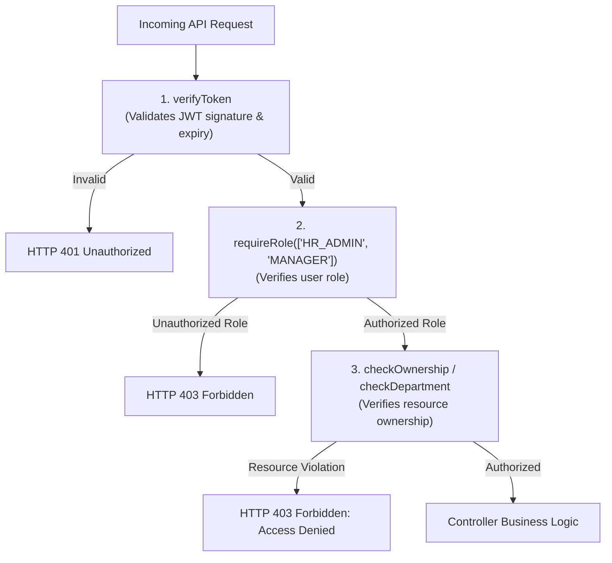

# StaffSync — Security, Privacy & Access Control Specification

**Target Standard:** Enterprise SaaS Best Practices / OWASP Top 10 Compliance  
**Version:** 1.0.0 (Phase 1 Specification)  

---

## 1. Authentication Strategy & Comparison

Three standard authentication patterns were evaluated for StaffSync:

| Strategy | Storage Location | XSS Vulnerability | CSRF Vulnerability | Implementation Complexity | Recommendation |
| :--- | :--- | :--- | :--- | :--- | :--- |
| **Option A: JWT in LocalStorage** | Browser `localStorage` | **High** (Accessible to any injected script) | **None** | Low | **Rejected** (Too risky for HR/Personal data) |
| **Option B: JWT in HTTP-Only Cookies** | Browser Cookie with `HttpOnly`, `Secure`, `SameSite=Lax` | **Very Low** (Inaccessible to JavaScript) | **Low** (Mitigated by `SameSite=Lax` and custom headers) | Moderate | **Recommended** (Best security/simplicity balance) |
| **Option C: Server-Side Redis Sessions** | Redis Store + Session ID Cookie | **Very Low** | **Low** | High (Requires Redis infrastructure & hosting cost) | **Rejected** (Unnecessary overhead for student project) |

### Recommended Architecture: JWT in HTTP-Only SameSite Cookies
* **Token Issuance:** Upon successful authentication at `/api/v1/auth/login`, the backend generates a signed JSON Web Token using `jsonwebtoken` signed with `JWT_SECRET` (256-bit entropy).
* **Cookie Configuration:**
  ```javascript
  res.cookie('token', token, {
    httpOnly: true, // Prevents client-side scripts from reading token (blocks XSS token theft)
    secure: process.env.NODE_ENV === 'production', // Transmitted strictly over HTTPS in production
    sameSite: process.env.NODE_ENV === 'production' ? 'none' : 'lax', // Supports cross-site frontend/backend deployment with HTTPS
    maxAge: 8 * 60 * 60 * 1000, // 8-hour session lifetime
    path: '/'
  });
  ```
* **Payload Boundary:** The token payload contains strictly non-sensitive identity metadata:
  ```json
  {
    "userId": "654c1f9b8c2d1e001a111111",
    "role": "EMPLOYEE",
    "employeeId": "654c1f9b8c2d1e001a222222",
    "departmentId": "654c1f9b8c2d1e001a333333",
    "iat": 1730080000,
    "exp": 1730108800
  }
  ```

---

## 2. Password Hashing & Management

1. **Algorithm:** Passwords are never stored in plaintext. Passwords are cryptographically salted and hashed using `bcryptjs`.
2. **Work Factor (Salt Rounds):** Minimum `10` rounds (approx. $100\text{ms}$ computational delay per hash on modern CPUs), providing robust resistance against brute-force and dictionary attacks.
3. **Mongoose Lifecycle Pre-Save Hook:** Password hashing is handled automatically before persisting `User` documents. If the password field has not been modified (`isModified('password') === false`), the hashing step is skipped.
4. **Database Projection Security:** The `password` field in the `User` schema is configured with `select: false`. It is never returned in standard queries unless explicitly requested using `.select('+password')` during the authentication verification step.

---

## 3. Role-Based & Resource-Level Authorization (RBAC)

StaffSync enforces defense-in-depth authorization through a multi-tier middleware pipeline.



### 3.1 Permission Matrix

| Operation / Resource | HR / Admin | Manager | Employee | Enforcement Mechanism |
| :--- | :---: | :---: | :---: | :--- |
| **Login / Logout** | Allowed | Allowed | Allowed | `verifyToken` |
| **View Own Profile** | Allowed | Allowed | Allowed | `verifyToken` |
| **Edit Own Personal Info** | Allowed | Allowed | Allowed | Ownership Check (`req.user.employeeId === targetId`) |
| **View Employee Directory** | Full | Department Members | Public Directory Card | Role Scope Filter in Service |
| **Create Employee Profile** | Allowed | Denied | Denied | `requireRole(['HR_ADMIN'])` |
| **Edit Job/Salary Details** | Allowed | Denied | Denied | `requireRole(['HR_ADMIN'])` |
| **Deactivate Employee** | Allowed | Denied | Denied | `requireRole(['HR_ADMIN'])` |
| **Manage Departments** | Allowed | Denied | Denied | `requireRole(['HR_ADMIN'])` |
| **Check In / Check Out** | Allowed | Allowed | Allowed | `verifyToken` (Records for `req.user.employeeId`) |
| **View Team Attendance** | All Org | Direct Reports Only | Denied | `requireRole(['MANAGER', 'HR_ADMIN'])` + Dept Check |
| **Apply for Leave** | Allowed | Allowed | Allowed | `verifyToken` (Applicant is `req.user.employeeId`) |
| **Approve / Reject Leave** | All Org | Direct Reports Only | Denied | Ownership Check (`target.employee.managerId === req.user.id`) |
| **Adjust Leave Quotas** | Allowed | Denied | Denied | `requireRole(['HR_ADMIN'])` |
| **Publish Announcements** | Allowed | Denied | Denied | `requireRole(['HR_ADMIN'])` |
| **Manage Training Sessions**| Allowed | Denied | Denied | `requireRole(['HR_ADMIN'])` |
| **Enroll in Training** | Allowed | Allowed | Allowed | Capacity Check + Ownership |
| **View Executive Analytics**| Full Org | Team Summary | Personal Stats | Role Scope Filter |
| **Access Audit Logs** | Allowed | Denied | Denied | `requireRole(['HR_ADMIN'])` |

---

## 4. Input Validation & Injection Defenses

### 4.1 NoSQL Injection Protection
Attackers can attempt NoSQL injection by passing query selector operators (e.g., `{"$gt": ""}`) in JSON bodies.
* **Mitigation:**
  * Cleanse all incoming request bodies, queries, and params using `mongo-sanitize`, which strips any keys starting with `$` or containing `.`.
  * Avoid raw query concatenation; use explicit Mongoose schema queries with strongly typed parameters.

### 4.2 Declarative Schema Validation (`express-validator`)
All incoming requests pass through strict validator chains before hitting controllers:
* Dates are verified as ISO 8601 strings.
* Email addresses are normalized and validated for proper email formatting.
* Enumerated strings (e.g., leave types, roles, statuses) are strictly whitelisted.
* Numeric values (hours, days, quotas) are bound by minimum and maximum constraints.

---

## 5. Network Security, Rate Limiting & HTTP Headers

### 5.1 Secure HTTP Headers via `helmet`
StaffSync configures `helmet` to establish secure browser policies:
* `Content-Security-Policy`: Restricts scripts and styles to trusted origins.
* `X-Frame-Options`: Sets `DENY` to eliminate Clickjacking attacks.
* `X-Content-Type-Options`: Sets `nosniff` to prevent MIME-type confusion attacks.
* `Strict-Transport-Security` (HSTS): Forces HTTPS transport in production (`maxAge: 31536000`, `includeSubDomains`).

### 5.2 Cross-Origin Resource Sharing (CORS)
Cross-origin access is strictly restricted to designated client origins:
```javascript
const allowedOrigins = [process.env.CLIENT_URL || 'http://localhost:5173'];
app.use(cors({
  origin: function (origin, callback) {
    if (!origin || allowedOrigins.includes(origin)) {
      callback(null, true);
    } else {
      callback(new Error('CORS policy violation: Origin not allowed.'));
    }
  },
  credentials: true, // Permits cookie transmission across origins
  methods: ['GET', 'POST', 'PUT', 'PATCH', 'DELETE'],
  allowedHeaders: ['Content-Type', 'Authorization']
}));
```

### 5.3 Brute-Force Rate Limiting
To defend against automated password guessing and credential stuffing:
* **Authentication Rate Limiting:** Enforces maximum 5 attempts per 15-minute window per IP on `/api/v1/auth/login`.
* **Global API Rate Limiting:** Enforces maximum 200 requests per 15-minute window per IP for standard API endpoints.

---

## 6. Audit Logging & Forensic Traceability

StaffSync maintains an immutable `AuditLog` collection capturing high-impact administrative and lifecycle modifications:
1. **Logged Events:**
   * Employee creation and deactivation.
   * Role and permission changes.
   * Manual leave balance overrides.
   * Department head reassignments.
   * Failed authentication spikes.
2. **Audit Record Format:**
   * `actorId`: User ID who initiated the operation.
   * `action`: Action verb (`CREATE`, `UPDATE`, `DELETE`, `STATUS_CHANGE`, `OVERRIDE`).
   * `targetEntity`: Affected collection (`EMPLOYEE`, `DEPARTMENT`, etc.).
   * `targetId`: ID of the target document.
   * `changes`: JSON delta showing previous and new values.
   * `ipAddress`: Remote client IP address.
   * `timestamp`: Immutable UTC timestamp.

---

## 7. Secrets Management & Environment Configuration

### 7.1 Separation of Code and Credentials
* Real credentials, database connection strings, and cryptographic secrets **must never be committed to Git**.
* All sensitive configuration is loaded via environment variables using `dotenv`.
* A template `.env.example` is committed to the repository with placeholder values to guide developers during local setup.

### 7.2 Required Configuration Variables
| Variable Name | Purpose | Example / Development Default |
| :--- | :--- | :--- |
| `NODE_ENV` | Application runtime environment | `development` or `production` |
| `PORT` | Backend server port | `5000` |
| `MONGO_URI` | MongoDB Atlas connection string | `mongodb+srv://<user>:<password>@cluster0.mongodb.net/staffsync?retryWrites=true&w=majority` |
| `JWT_SECRET` | Secret key used for signing session tokens | High-entropy 64-character random string |
| `JWT_EXPIRES_IN` | Token validity duration | `8h` |
| `CLIENT_URL` | Trusted frontend origin for CORS | `http://localhost:5173` or `https://staffsync.vercel.app` |

---

## 8. Data Privacy & Leakage Prevention

1. **Safe Error Handling:**
   * Production error handlers return generic messages (e.g., `"Internal server error occurred"`).
   * Detailed stack traces, MongoDB error codes, and server file paths are completely suppressed in production environments.
2. **Sensitive Profile Masking:**
   * Employees viewing the general directory cannot see emergency contact numbers, home addresses, or compensation bands of colleagues.
3. **Database Security:**
   * MongoDB Atlas access is secured with SCRAM-SHA-256 user authentication and restricted via Atlas IP Whitelisting (`0.0.0.0/0` only permitted with strong credentials, or explicitly bound to hosting provider IPs).
   * Automated daily backups are maintained through MongoDB Atlas snapshot management.

