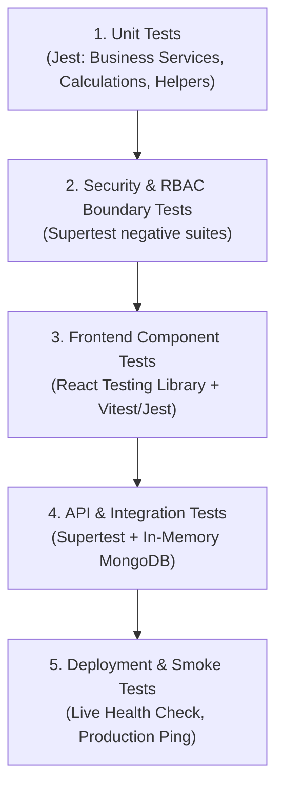

# StaffSync — Comprehensive Quality Assurance & Testing Strategy

**Testing Standards:** Full-Stack Verification & Defect Prevention  
**Core Frameworks:** Jest, Supertest, React Testing Library (RTL)  
**Version:** 1.0.0 (Phase 1 Specification)  

---

## 1. Testing Philosophy & Non-Negotiable Rules

1. **Execution-Based Reporting Rule:**
   * A test may only be reported as **PASSED** if it has been physically executed against a live runtime or test harness and yielded an exit code of `0`.
   * Untested, mock-only, or planned test cases must be clearly categorized as **SKIPPED** or **BLOCKED**.
   * Under no circumstances will a successful production build or compilation step be cited as evidence that business logic or authorization boundaries function correctly.
2. **Shift-Left Security & Authorization Testing:**
   * Authorization rules (RBAC) are verified with dedicated negative test cases (e.g., verifying that an `EMPLOYEE` role receives `HTTP 403 Forbidden` when attempting to delete a department or approve their own leave).

---

## 2. Testing Pyramid & Tooling Ecosystem



### Tooling Selection
* **Backend Unit & Integration Testing:** **Jest** (test runner and assertion engine) + **Supertest** (HTTP endpoint assertion without binding physical network ports) + **`mongodb-memory-server`** (isolated in-memory database testing without impacting production Atlas data).
* **Frontend Component Testing:** **React Testing Library** (user-centric DOM testing) + **Jest / Vitest**.
* **Manual & Exploratory API Testing:** Postman / Insomnia collections with pre-configured environment tokens.
* **Linting & Code Quality:** ESLint + Prettier.

---

## 3. Testing Levels & Scope

### 3.1 Unit Testing (Business Services & Calculations)
* **Scope:** Isolated testing of domain service methods in `server/src/services/`.
* **Key Targets:**
  * Daily working hours calculation from check-in and check-out timestamps.
  * Late check-in status determination based on the 09:30 AM boundary.
  * Leave balance deduction and insufficient quota rejection logic.
  * Leave date overlap detection algorithms.

### 3.2 Security & Authorization Testing (RBAC Middleware)
* **Scope:** Systematic verification of access control on all protected routes.
* **Key Scenarios:**
  * Request without token $\rightarrow$ `HTTP 401 Unauthorized`.
  * Request with expired/tampered JWT $\rightarrow$ `HTTP 401 Unauthorized`.
  * Employee attempting to access `/api/v1/departments` (POST/PUT/DELETE) $\rightarrow$ `HTTP 403 Forbidden`.
  * Manager attempting to approve leave for an employee outside their department $\rightarrow$ `HTTP 403 Forbidden`.
  * Employee attempting to read another employee's private profile $\rightarrow$ `HTTP 403 Forbidden`.

### 3.3 API Integration Testing (End-to-End Route Execution)
* **Scope:** Full HTTP request-response cycle from Express route through middleware, controller, service, and database persistence.
* **Key Scenarios:**
  * User login flow: Valid credentials issue signed cookie; invalid credentials return 401.
  * Check-in workflow: First check-in succeeds; second check-in on the same day returns `HTTP 409 Conflict`.
  * Leave application workflow: Submitting leave creates record in `PENDING` status; manager approval transitions status to `APPROVED` and decrements `LeaveBalance`.

### 3.4 Frontend Component & UI State Testing
* **Scope:** Verification of UI components under varying states.
* **Key Scenarios:**
  * `PunchClockWidget`: Renders "Check In" button when not punched in; toggles to "Check Out" once punched in.
  * `LeaveForm`: Disables submit button and shows validation warning if end date is prior to start date.
  * UI State rendering: Loading skeleton appears while fetching; empty illustration displays when zero records exist; server error banner appears on 500 responses.

### 3.5 Responsive UI & Accessibility Testing
* **Scope:** Manual and automated viewport testing across standard breakpoints ($375\text{px}$ mobile, $768\text{px}$ tablet, $1200\text{px}$ desktop).
* **Key Scenarios:**
  * Navigation bar transforms into responsive offcanvas menu on screens $<768\text{px}$.
  * Data tables adapt to horizontal scrolling or stacked viewports on mobile devices.
  * Color contrast ratios satisfy WCAG 2.1 AA requirements ($\ge 4.5:1$).

### 3.6 Production Build Verification & Smoke Testing
* **Scope:** Verification that minified client and server builds compile cleanly without errors.
* **Smoke Test Checklist:**
  * Backend responds with `200 OK` on `/api/v1/health`.
  * Database connectivity confirms `"status": "connected"`.
  * Frontend root loads index HTML with all bundled CSS and JS chunks.
  * Seeded demo accounts can log in successfully.

---

## 4. Measurable Acceptance Criteria by Module

| Module | Feature | Acceptance Criteria (Measurable) |
| :--- | :--- | :--- |
| **Auth** | Login | Returns 200 and sets HTTP-only cookie when valid credentials provided; returns 401 on incorrect password. |
| **Auth** | Rate Limiting | 6th failed login attempt within 15 minutes from same IP returns `HTTP 429 Too Many Requests`. |
| **Attendance** | Daily Check-In | Creates attendance document with ISO timestamp; sets status `LATE` if after 09:30 AM; returns 409 on duplicate same-day punch. |
| **Attendance** | Check-Out | Computes accurate decimal hours worked; prevents double check-out; sets status `HALF_DAY` if duration $< 4\text{h}$. |
| **Leaves** | Application | Rejects submission if `requested_days > balance`; rejects date ranges overlapping an existing approved/pending leave. |
| **Leaves** | Approval | Manager approval decrements employee `LeaveBalance.used`; sets `reviewedBy` and `reviewedAt`; creates in-app notification. |
| **Employees** | Onboarding | Only HR can create employee; automatically generates linked `User` record; verifies unique email and employeeCode. |
| **Employees** | Deactivation | Sets `status: "INACTIVE"` and `User.isActive: false`; rejects future logins; retains attendance and leave history. |
| **Departments** | Management | Prevents deletion or deactivation of department if active employees are assigned to it. |
| **Training** | Enrollment | Decrements available capacity count; blocks enrollment if capacity is zero; blocks duplicate enrollment by same employee. |

---

## 5. Test Execution Protocol & Reporting Format

Every phase test report will follow this standardized reporting schema:

```markdown
### Test Execution Summary: Phase [X]
- **Execution Date:** [YYYY-MM-DD]
- **Environment:** Local Test Harness / Staging Cloud
- **Total Test Cases:** [Count]
- **Results:**
  - ✅ **PASSED:** [Count]
  - ❌ **FAILED:** [Count]
  - ⏸️ **SKIPPED:** [Count]
  - 🚫 **BLOCKED:** [Count]

| Test ID | Module | Scenario | Expected Outcome | Actual Result | Status |
| :--- | :--- | :--- | :--- | :--- | :---: |
| TC-AUTH-01 | Auth | Login with valid credentials | 200 OK + JWT Cookie | 200 OK + JWT Cookie | PASSED |
| TC-AUTH-02 | Auth | Access protected route without token | 401 Unauthorized | 401 Unauthorized | PASSED |
| TC-RBAC-01 | Employees | Employee creates employee profile | 403 Forbidden | 403 Forbidden | PASSED |
```

